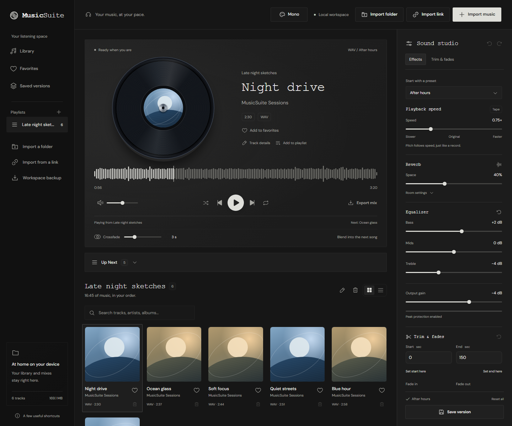

# MusicSuite

Download music from YouTube and SoundCloud, import your own files, and make the sound your own.

**No account needed. Your library stays on your computer.**

[**Download for Windows**](https://github.com/06T/MusicSuite/releases/download/v0.4.1/MusicSuite-0.4.1-Windows-x64.zip) · [Release notes](https://github.com/06T/MusicSuite/releases/tag/v0.4.1) · [Checksum](https://github.com/06T/MusicSuite/releases/download/v0.4.1/MusicSuite-0.4.1-Windows-x64.zip.sha256)



## What you can do

- **Download music:** save audio from YouTube videos, SoundCloud tracks, YouTube playlists, and SoundCloud playlists/sets to your library.
- **Import your files:** add individual songs or whole folders, with album art when available.
- **Organize your library:** search, favorite songs, build playlists, and reorder or remove upcoming songs without deleting them.
- **Adjust the sound:** change speed from 0.5× to 1.5×, add reverb, and adjust bass, mids, and treble while listening.
- **Keep the music flowing:** blend songs with crossfade and keep your effects as the next song starts.
- **Save and export:** keep named versions of your mixes and export them as WAV. Your originals stay unchanged.
- **Make it yours:** choose a built-in theme or save your own background and accent colors.

## Download from YouTube or SoundCloud

Click **Import link**, paste a public song or playlist link, then choose **Import audio** or **Import playlist**.

MusicSuite uses [yt-dlp](https://github.com/yt-dlp/yt-dlp) to download audio from YouTube and SoundCloud, and FFmpeg to convert it to **MP3**. Songs are added to your library with the title, artist, and cover art when available. Downloaded songs work offline and can be edited, saved as mixes, or exported.

- Playlists support **up to 100 entries** and become local playlists in their original order.
- Watch download progress while you keep listening.
- Cancel anytime; completed songs stay in your library.
- Paste the same link again to retry missing songs. Existing downloads are reused.

Each song can be up to **20 minutes / 100 MB**. Public, accessible audio only—use content you own or have permission to download.

The Windows portable download includes yt-dlp, FFmpeg, and ffprobe, ready to use.

## Get started

**Windows 10 (22H2) or Windows 11, 64-bit:**

1. [Download the Windows ZIP](https://github.com/06T/MusicSuite/releases/download/v0.4.1/MusicSuite-0.4.1-Windows-x64.zip).
2. Extract the entire ZIP into a folder.
3. Double-click **MusicSuite.exe**.

MusicSuite opens in your browser. **No installation or terminal commands needed**—Node.js and the download tools are included.

Use the MusicSuite icon in the Windows notification area to reopen the app or **Quit**. Closing the browser tab keeps MusicSuite running. Your library stays in `%LOCALAPPDATA%\MusicSuite\Library`, so replacing the app folder preserves your music.

<details>
<summary>Run from source instead</summary>

Install [Node.js](https://nodejs.org/en/download) **24 or newer**, download the source with **Code → Download ZIP**, and extract it. On Windows, double-click **Start MusicSuite.cmd**. Its first launch installs dependencies and builds the app; keep the terminal window open while listening.

Or open a terminal in the source folder and run:

```sh
npm ci
npm run build
npm start
```

Then open [MusicSuite](http://127.0.0.1:3333/) in your browser.

Source installations need the [download-tool setup](docs/usage.md#link-imports) for YouTube and SoundCloud imports.

</details>

## Make your first mix

1. Click **Import music** or **Import folder** and choose your audio.
2. Press **Play**, then try a preset or adjust the sound controls.
3. Click **Save version** to keep your mix, or **Export mix** to download it.

Your original files stay unchanged. You can also try the built-in demo before importing anything.

## Need help?

See the [Windows portable guide](docs/windows-portable.md) for launch and update help, or the [user guide](docs/usage.md) for features, backups, and troubleshooting.

## License

MusicSuite is **All rights reserved**. Official releases are available for personal use; source code is provided for viewing. See [LICENSE.txt](LICENSE.txt). Bundled third-party tools retain their own licenses and notices.
